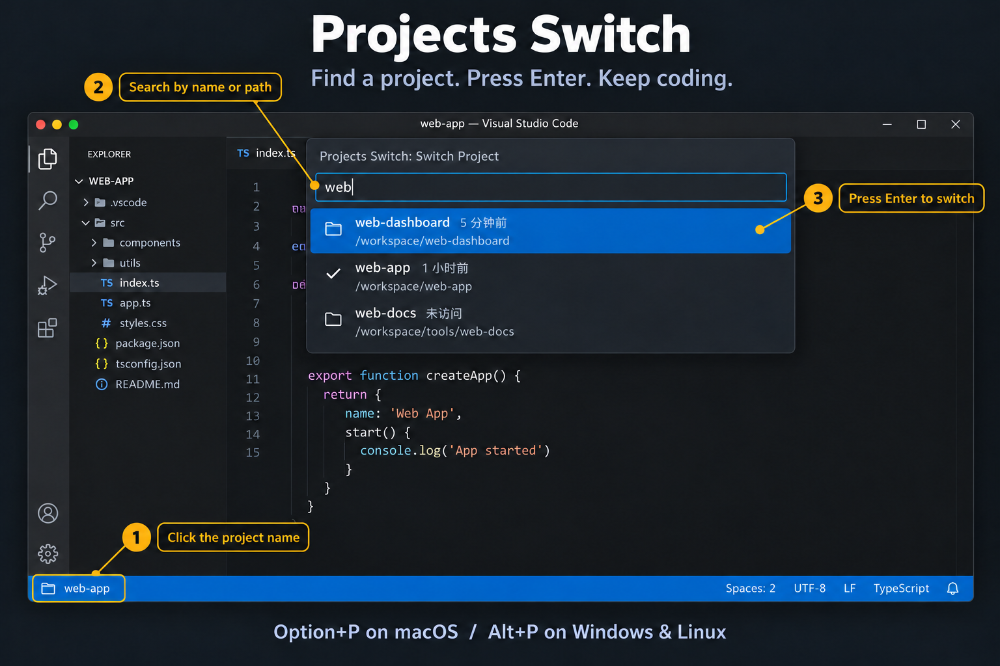

<p align="center">
  
</p>

# Projects Switch

Find and switch Git projects from the VS Code status bar.

- **Project** — find Git projects, including nested repositories, with recently visited projects first.

Click the project button, type to search, and press `Enter` to select.

To keep your current window open, click the button on the right of a project row, labeled **在新窗口打开** (open in new window). It opens that project's last visited workspace or worktree in a new window. Selecting a row or pressing `Enter` keeps the usual switching behavior.



*Simulated demo with example projects. The picker shows project paths and recent visit times; the checkmark identifies the current project.*

[Source code](https://github.com/joisun/projects-switch) · [Report an issue](https://github.com/joisun/projects-switch/issues)

## Shortcuts

| Action | macOS | Windows / Linux |
| --- | --- | --- |
| Switch Project | `Option+P` | `Alt+P` |

Customize these in **Keyboard Shortcuts** by searching for `Projects Switch`. **Add Project** and **Refresh Projects** are available in the Command Palette.

## Configuration

Set the directories to scan in VS Code settings:

```jsonc
{
  "projectsSwitch.projects.scanRoots": [
    "$WORKSPACE"
  ],
  "projectsSwitch.projects.excludes": [
    "**/archived/**"
  ],
  "projectsSwitch.projects.maxDepth": 4
}
```

- `scanRoots`: absolute directories, optionally using environment variables. `$WORKSPACE` must be an environment variable available to VS Code, not the currently opened folder. Relative paths, `~`, and filesystem roots are not supported.
- `excludes`: directory patterns to skip.
- `maxDepth`: maximum scan depth; the scan root is depth `0`.

## Moving from DevHop

Install `sunzhongyi.projects-switch` and uninstall DevHop. Copy any `projectSwitcher.projects.*` settings to `projectsSwitch.projects.*`. Recently visited and manually added projects are not transferred. Branch switching is handled by VS Code’s built-in Source Control Checkout.
